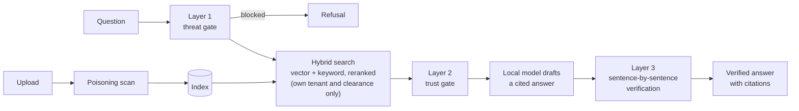

<div align="center">
  
  <h1>ATTS-RAG</h1>
  <p><strong>Adaptive Threat-Intelligence Trusted &amp; Secure Retrieval-Augmented Generation</strong></p>

  [](https://www.python.org/)
  [](https://fastapi.tiangolo.com/)
  [](https://ollama.com/)
  [](https://streamlit.io/)
</div>

---

## Contents

- [What it is](#what-it-is)
- [How it works](#how-it-works)
- [Latest update](#latest-update)
- [Install](#install)
- [Use it](#use-it)
- [Accounts, roles and access](#accounts-roles-and-access)
- [API](#api)
- [Configuration](#configuration)
- [Project layout and further reading](#project-layout-and-further-reading)

---

## What it is

ATTS-RAG lets people ask questions about their organisation's documents (PDF, DOCX, TXT, Markdown) and get answers in which every sentence is checked against the documents and cited. It runs entirely on your own machine: answers come from a local model through Ollama, and embeddings, search and verification use local models. No document or question leaves the computer.

Around the usual retrieve-and-answer loop it adds three security layers:

- **Layer 1, query threat gate:** screens each question for prompt injection, jailbreaks and social engineering (rules, similarity to known attacks, a multilingual classifier and an authority-claim check), and becomes stricter with a user who keeps probing.
- **Layer 2, trust gate:** keeps only evidence the user may see (tenant and clearance), whose content hash is intact, and whose source is trustworthy enough; personal data is masked.
- **Layer 3, evidence-to-answer gate:** checks every sentence of the draft answer against the evidence with a natural-language-inference model plus number, negation and table checks, and drops what the evidence does not support. Charts are shown only if their numbers are in the evidence.

Uploaded documents are scanned for hidden instructions before they are indexed; suspicious passages are quarantined instead of indexed.

---

## How it works



A per-user suspicion value, raised by evidence from all three layers and fading over time, tightens the thresholds of every layer for that user.

---

## Latest update

**10 November 2026: accounts, roles, access control and stricter answer release**

- **Four roles:** viewer, user, tenant admin and super admin. Accounts that had the old `admin` role became super admins automatically.
- **Clearance levels** (1 general, 2 confidential, 3 restricted) for accounts and documents. A user only retrieves, lists and previews documents at or below their clearance.
- **Account management** on a new Admin page: change roles, clearance and status, disable or delete accounts, issue one-time password-reset codes, and manage invite codes (with expiry, use limits and revocation).
- **Sessions:** 15-minute access tokens that the app renews on its own with single-use refresh tokens, so nobody is logged out mid-conversation.
- **Two-factor log-in** with any authenticator app, optional or required per role.
- **Audit log** of log-ins and account changes, hash-chained so that edits are detected.
- **Tenant isolation fixes:** document IDs and uploads are separate per tenant, sign-up needs an invite code by default, and failed log-ins lock an account only for the network they came from.

- **Stricter answer release:** headings, lead-ins, "the documents do not mention ..." notes, the "Understood as" line and chart titles can no longer carry an unchecked fact. Anything that states a number, a negation or a new claim is verified like any other sentence or left out. The evaluation results are unchanged.

Existing users and documents keep exactly the access they had. Earlier in November: an improved answer verifier (version 3) that keeps more correct sentences while catching the same errors.

---

## Install

### What you need

- **Python 3.11 or newer**
- **[Ollama](https://ollama.com/)**, running, with the answer model pulled:
  ```powershell
  ollama pull llama3
  ```
- Several GB of disk space for the models (the `llama3` model alone is about 4.7 GB). The first start downloads the embedding, reranking, classifier and verification models from Hugging Face; after that it runs offline.

### Option A: on your machine (Windows, macOS or Linux)

```powershell
git clone https://github.com/SakthiQ/ATTS-RAG.git
cd ATTS-RAG
python -m venv .venv
.\.venv\Scripts\Activate.ps1          # macOS / Linux: source .venv/bin/activate
pip install -r requirements.txt
copy .env.example .env                 # macOS / Linux: cp .env.example .env
```

Open `.env` and set at least `JWT_SECRET` to a long random value (if you leave it empty, one is generated and kept in `data/.jwt_secret`). To keep downloaded models on another drive, set `ATTS_MODEL_DIR` (and `HF_HOME` / `OLLAMA_MODELS` in your environment).

Create the first administrator; the password is asked for, not typed on the command line:

```powershell
python scripts/manage_users.py create --username admin --role super_admin
```

### Option B: with Docker

```powershell
git clone https://github.com/SakthiQ/ATTS-RAG.git
cd ATTS-RAG
copy .env.example .env
docker compose up -d --build
docker compose exec ollama ollama pull llama3
docker compose exec backend python scripts/manage_users.py create --username admin --role super_admin
```

The app is then at http://localhost:8501 and the API at http://localhost:8000.

---

## Use it

### Start

In two terminals, with the virtual environment active:

```powershell
uvicorn app.main:app
```

```powershell
streamlit run frontend/streamlit_app.py
```

Open http://localhost:8501 and log in.

### Everyday use

1. **Upload documents** from the sidebar (**📤 Upload Document**). They are scanned and indexed in the background; the **📚 Document Library** shows the progress and then the result (chunks indexed, flagged or quarantined). Admins can also set a document's trust tier and clearance. Multi-column PDF pages such as slides are read column by column.
2. **Ask a question** in the chat box. The answer cites its sources as `[E1]`, `[E2]`, ...; click a source button to see the passage and how each sentence was verified. If the documents do not support an answer, the app says so instead of guessing. You can keep typing while an answer is on its way: further questions wait their turn.
3. **👤 Account**: change your password and turn on two-factor log-in.
4. **🛠️ Admin** (tenant and super admins): manage users, invites, document clearance, and read the audit log.

### Invite people

Sign-up needs an invite code by default. An admin creates one on the Admin page (**Invites**) or with:

```powershell
python scripts/manage_users.py create-invite --tenant default_tenant --uses 10 --hours 72
```

and shares it; whoever signs up with it joins that tenant with the invite's role. Admins can also create accounts directly.

### Forgotten password

An admin issues a one-time reset code (Admin page, or `python scripts/manage_users.py reset-password --username alice`). The user enters it under **Reset password** on the log-in screen. No e-mail service is needed.

### Maintenance

```powershell
python scripts/check_index.py                       # check that the indexes and registry agree
python scripts/reingest_corpus.py --rebuild         # rebuild the index from the files in data/ (stop the backend first)
python scripts/manage_users.py list                 # list accounts
python scripts/manage_users.py audit-verify         # check the audit log has not been edited
pytest tests                                        # run the test suite
```

---

## Accounts, roles and access

| | Viewer | User | Tenant admin | Super admin |
|---|:-:|:-:|:-:|:-:|
| Ask questions; read documents of their tenant up to their clearance | Yes | Yes | Yes | Yes, every tenant |
| Upload documents (as unvetted) into their tenant | | Yes | Yes | Yes |
| Trust tiers, new document versions, deletion, document clearance | | | own tenant | every tenant |
| See unmasked personal data ("Answer as admin") | | | Yes | Yes |
| Manage accounts and invites, read the audit log | | | own tenant | everything |

- **Tenants** keep organisations apart: a user never retrieves, lists or learns the names of another tenant's documents or accounts.
- **Clearance** (1 general, 2 confidential, 3 restricted) works inside a tenant: documents above a user's clearance are never retrieved or listed. Admins see every level of the tenants they manage.
- **Sessions** end after 7 days without use; the 15-minute access token is renewed automatically. Logging out, changing a password or changing an account's role or status ends its sessions at once.
- **Log-in protection:** five wrong passwords lock the account for 15 minutes, but only for the network they came from, so nobody can lock someone out from elsewhere. Too many failures from one network over all usernames block that network for an hour.
- **Two-factor log-in:** set up on the Account page with any authenticator app; recovery codes cover a lost phone, and an admin can reset it. Set `REQUIRE_2FA_ROLES=tenant_admin,super_admin` to make it compulsory for admins.
- **Personal data** (social security numbers, card numbers, e-mail addresses) is masked in answers. An admin can ask for it unmasked; every such answer is recorded in `logs/admin_view_audit.jsonl`. API keys and other secrets always stay masked.
- **Audit log:** log-ins, lock-outs, account and invite changes, two-factor changes and document deletions are written to `logs/auth_audit.jsonl`, never with passwords or codes.

---

## API

The backend is a FastAPI service; interactive documentation is at http://localhost:8000/docs (use **Authorize** to log in). Every call except `/health` needs a bearer token.

```bash
# Log in (add "otp": "123456" for an account with two-factor log-in)
curl -X POST http://127.0.0.1:8000/auth/login -H "Content-Type: application/json" \
     -d '{"username": "alice", "password": "..."}'
# -> {"access_token": "...", "refresh_token": "...", "expires_in": 900, ...}

# Ask a question
curl -X POST http://127.0.0.1:8000/query -H "Authorization: Bearer $TOKEN" \
     -H "Content-Type: application/json" -d '{"question": "What is the MFA policy?"}'

# Upload a document
curl -X POST http://127.0.0.1:8000/upload -H "Authorization: Bearer $TOKEN" -F "file=@Policy.pdf"
```

| Area | Endpoints |
|---|---|
| Health | `GET /health` |
| Log-in and sessions | `POST /auth/signup`, `/auth/login`, `/auth/refresh`, `/auth/logout`, `GET /auth/me` |
| Own account | `POST /auth/password`, `/auth/password/reset`, `/auth/2fa/setup`, `/auth/2fa/enable`, `/auth/2fa/disable` |
| Administration | `GET POST /auth/users`, `PATCH DELETE /auth/users/{username}`, `POST /auth/users/{username}/reset`, `DELETE /auth/users/{username}/2fa`, `GET POST /auth/invites`, `DELETE /auth/invites/{id}`, `GET /auth/audit` |
| Documents | `POST /upload`, `GET /ingestion/{document_id}` (progress of a recent upload), `GET /documents`, `GET /documents/{hash}/preview`, `PATCH /documents/{hash}` (clearance), `DELETE /documents/{hash}` |
| Questions | `POST /query` |

A `/query` response contains the `answer` (every sentence ends with the `[E#]` it rests on), the `citations` with their passages, an optional `chart`, and each layer's verdict (`threat_gate`, `layer2_gate`, `layer3_gate`). On a CPU-only machine with a local 8B model, expect roughly 50-100 seconds per answered question; blocked and off-topic questions return at once.

---

## Configuration

Settings live in `.env`; `.env.example` lists them all with explanations. The ones you are most likely to change:

| Setting | Default | Meaning |
|---|---|---|
| `JWT_SECRET` | generated | Key that signs log-in tokens |
| `SIGNUP_MODE` | `invite` | `invite`, `open` (anyone may join the default tenant) or `closed` (admins create accounts) |
| `JWT_EXPIRE_MINUTES` / `REFRESH_EXPIRE_DAYS` | 15 / 7 | Access-token and session lifetime |
| `REQUIRE_2FA_ROLES` | empty | Roles that must use two-factor log-in |
| `TOTP_KEY` | generated | Encrypts stored 2FA secrets; back it up together with `data/users.db` |
| `OLLAMA_MODEL` | `llama3` | Local model for answers and the upload scan (the health check reports it if it is not pulled) |
| `OLLAMA_MAX_CONCURRENCY` | 1 | Model calls at the same time; raise it on a GPU host |
| `ATTS_QUERY_TIMEOUT` | 900 | How long the app waits for an answer, in seconds |
| `ATTS_MODEL_DIR` | empty | Folder with local copies of the Hugging Face models |
| `HF_HUB_OFFLINE` | empty | Set to `1` after the first run so nothing is fetched from the network |

Behind a reverse proxy, start uvicorn with `--proxy-headers` so the log-in limits see the real client address.

Data is kept in `data/` (accounts in `users.db`, uploads in `uploads/<tenant>/`), the index in `chroma_db/`, and logs in `logs/`. Back up these folders, together with `.env`. A rebuild (`reingest_corpus.py --rebuild`) keeps the old index as a backup and re-creates every document with its tenant, document ID, trust tier, clearance and version; uploads an admin deleted are not brought back.

---

## Project layout and further reading

```
app/                FastAPI backend: auth.py, auth_admin.py, audit.py, totp.py, routes.py
app/rag/            pipeline: loader, chunker, vector store, Layer 1 (threat_gate.py),
                    Layer 2 (trust_gate.py), Layer 3 (layer3/), ingestion scan
frontend/           Streamlit app
scripts/            user management, index maintenance, evaluation
config/             threat patterns and classifier weights
tests/              test suite (pytest)
docs/               design notes and evaluation write-ups
```

| Topic | Document |
|---|---|
| Layer 1, query threat gate | [docs/Layer1_Adaptive_Threat_Intelligence_Gate.md](docs/Layer1_Adaptive_Threat_Intelligence_Gate.md) |
| Adaptive suspicion | [docs/Adaptive_Suspicion.md](docs/Adaptive_Suspicion.md) |
| Layer 3, answer verification | [docs/Layer3_Evidence_To_Answer_Gate.md](docs/Layer3_Evidence_To_Answer_Gate.md) |
| Upload scanning and indexing | [docs/Knowledge_Ingestion.md](docs/Knowledge_Ingestion.md) |
| Poisoning study | [docs/Poisoning_Study.md](docs/Poisoning_Study.md) |
| Results on public benchmarks | [docs/Public_Benchmarks.md](docs/Public_Benchmarks.md) |
| Models and evaluators | [docs/Models_and_Evaluators.md](docs/Models_and_Evaluators.md) |
