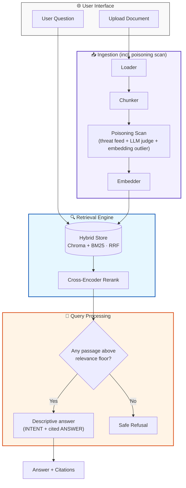
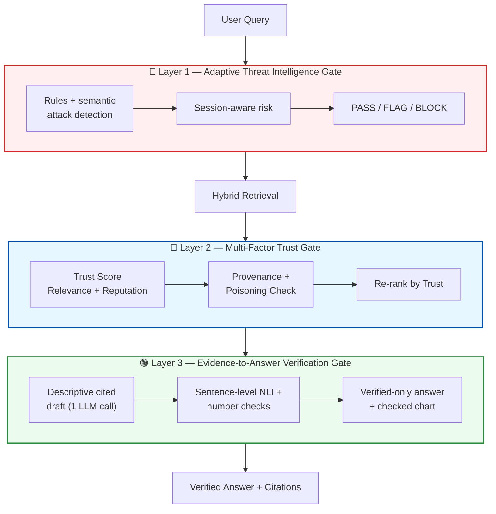

<div align="center">
  
  <h1>ATTS-RAG</h1>
  <p><strong>Adaptive Threat-Intelligence Trusted &amp; Secure RAG Platform</strong></p>

  [](https://github.com/SakthiQ/ATTS-RAG/blob/main/LICENSE)
  [](https://www.python.org/)
  [](https://fastapi.tiangolo.com/)
  [](https://ollama.com/)
  [](https://streamlit.io/)
  []()
</div>

---

## 📌 Table of Contents

- [What is ATTS-RAG?](#-what-is-atts-rag)
- [Cutting-Edge Features](#-cutting-edge-features)
- [Architecture](#-architecture)
- [🛡️ ATTS-RAG Security Architecture](#️-atts-rag-security-architecture)
- [Quick Start](#-quick-start-5-minutes)
- [Interactive Demo](#-interactive-demo)
- [API Guide](#-api-guide)
- [Technology Stack](#️-technology-stack)
- [Roadmap](#-roadmap)

---

## 🎯 What is ATTS-RAG?

**ATTS-RAG** (Adaptive Threat-intelligence Trusted & Secure RAG) is an enterprise-grade, privacy-first Retrieval-Augmented Generation platform. It wraps local PDF, DOCX, and Markdown document search in a zero-trust defense-in-depth security framework.

> [!IMPORTANT]
> **100% Local Logic**: No data ever leaves your machine. We use Ollama for local LLM inference, Sentence-Transformers for embeddings, and ChromaDB for vector retrieval.

This repository is the complete operational reference implementation for **ATTS-RAG** — wrapping the retrieve-and-generate loop in three active security gates (Query Threat Gate, Trust-Weighted Retrieval Gate, and Evidence-to-Answer Anti-Hallucination Gate) backed by an offline quality improvement flywheel.

---

## ✨ Cutting-Edge Features

| Feature | Description | Status |
| :--- | :--- | :---: |
| 🔴 **Layer 1 — Query Threat Gate** | Screens queries for prompt injections and jailbreaks; a per-user suspicion value, fed by all three layers, tightens the thresholds of every layer for users who keep probing. | ✅ Operational |
| 🔵 **Layer 2 — Multi-Factor Trust Gate** | Discrete decision tree filtering evidence by source tier, anomaly score, content hash, and tenant authorization. | ✅ Operational |
| 🟢 **Layer 3 — Evidence Verification Gate** | Anti-hallucination verification: sentence-level NLI against evidence windows, number and negation guards, citation repair, and evidence-checked charts. | ✅ Operational |
| 🖥️ **Streamlit UI Security Bar** | Three-pane workspace: documents on the left, answer with chart in the centre, and a closable evidence panel on the right (click a source button to see the passage and per-sentence verification). Live 3-layer status bar and health probe. | ✅ Operational |
| 🔄 **Offline Improvement Flywheel** | Automated sampling of REJECTs and near-threshold claims (`sample_audit_logs.py`), latency benchmarks, and CI gate. Review and threshold calibration are still manual. | 🟡 Partial |
| ⚡ **PyMuPDF Fast Rendering** | High-performance PDF page rendering (`fitz`) with rapid OCR fallback for scanned and image-heavy documents. | ✅ Operational |
| 🕵️ **Ingestion Poisoning Scan** | Screens uploads for hidden prompt injections (threat-feed regex + LLM judge + embedding-outlier check). | ✅ Operational |
| 🔍 **Hybrid Vector + BM25 Search** | Combines Chroma DB vector embeddings with BM25 keyword matching using Reciprocal Rank Fusion (RRF). | ✅ Operational |
| 🧠 **Cross-Encoder Re-ranking** | Micro-re-ranking with `cross-encoder/ms-marco-MiniLM-L-6-v2` for precise passage retrieval. | ✅ Operational |
| 🛑 **Safe Refusal Guarantee** | Refuses to generate unsupported claims when evidence is missing or fails NLI verification. | ✅ Operational |

---

## 🏗️ Architecture

The complete ATTS-RAG pipeline: query processing, hybrid retrieval, ingestion poisoning scan, and three security layers wrapping the retrieve-and-generate loop.



> This diagram shows the core retrieval and ingestion pipeline. The three ATTS-RAG security layers that wrap it are detailed in the next section.

---

## 🛡️ ATTS-RAG Security Architecture

ATTS-RAG wraps the pipeline above in three security layers. All three layers are implemented and tested. The trust metadata (`source_tier`, `anomaly_score`, content hashes) written at ingestion time is actively used at query time for authorization, integrity, and provenance verification.



| Layer | What it does | Status | Documentation & Specs |
| :--- | :--- | :---: | :--- |
| **Knowledge Ingestion** | Rapid PDF rendering (`fitz`) + chunking, local embedding, content-hash registry, hybrid vector/BM25 index. | ✅ Operational | [`loader.py`](app/rag/loader.py), [`chunker.py`](app/rag/chunker.py), [`vectorstore.py`](app/rag/vectorstore.py) |
| **Ingestion Poisoning Scan** | Regex threat feed + LLM judge + embedding-outlier scoring on every uploaded chunk; quarantines rather than indexes suspicious content. | ✅ Operational | [`ingestion_guard.py`](app/rag/ingestion_guard.py), [`injection_patterns.yaml`](config/injection_patterns.yaml) |
| **Layer 1 — Threat Intelligence Gate** | Screens queries with deterministic regex rules, a capped embedding-similarity signal and a flag-only trained classifier for paraphrased, multilingual and social-engineering attacks. PASS / FLAG / BLOCK, with thresholds that tighten as the user's suspicion grows (see the adaptive row below). | ✅ Operational | [`Layer1_Adaptive_Threat_Intelligence_Gate.md`](docs/Layer1_Adaptive_Threat_Intelligence_Gate.md), [`threat_gate.py`](app/rag/threat_gate.py) |
| **Layer 2 — Multi-Factor Trust Gate** | Discrete decision tree using source tier, anomaly score, content-hash integrity, tenant authorization, and field redaction. | ✅ Operational | [`trust_gate.py`](app/rag/trust_gate.py), [`field_redactor.py`](app/rag/field_redactor.py), [`deletion_propagation.py`](app/rag/deletion_propagation.py) |
| **Layer 3 — Evidence Verification Gate** | One-call descriptive answer with intent understanding; every sentence verified by NLI plus number/negation checks; unsupported sentences dropped; chart released only if its data is in the evidence. | ✅ Operational | [`Layer3_Evidence_To_Answer_Gate.md`](docs/Layer3_Evidence_To_Answer_Gate.md), [`app/rag/layer3/`](app/rag/layer3/) |
| **Adaptive suspicion** | One per-user suspicion value (tenant + user + IP subnet), raised by evidence from Layers 1-3 and decaying with time. It lowers Layer 1's thresholds, withholds unverified-source evidence in Layer 2 and raises Layer 3's verification strictness. On the test split it cut released attack turns from 100% to 45% with no extra benign blocks. | ✅ Operational | [`Adaptive_Suspicion.md`](docs/Adaptive_Suspicion.md), [`session_trust.py`](app/rag/session_trust.py) |
| **Offline Improvement Flywheel** | Telemetry audit log sampling (`sample_audit_logs.py`), latency regression benchmarker, and CI workflow integration. Review and threshold calibration are manual. | 🟡 Partial | [`Offline_Flywheel_Operations.md`](docs/Offline_Flywheel_Operations.md), [`sample_audit_logs.py`](scripts/sample_audit_logs.py) |

> [!NOTE]
> All three ATTS-RAG security layers are operational and covered by the test suite (`pytest tests/`), which CI runs on every push and pull request to `main`; the offline flywheel is partial (sampling, audit log and latency gate exist; review and calibration are manual). See [`docs/reports/Frontend_Architecture_Report.md`](docs/reports/Frontend_Architecture_Report.md) for the UI architecture report and [`docs/Offline_Flywheel_Operations.md`](docs/Offline_Flywheel_Operations.md) for flywheel operations.

---

## � Quick Start (5 Minutes)

### 1. Prerequisite Checklist
*   [ ] **Python 3.11+** installed.
*   [ ] **Ollama** installed and running.
*   [ ] Run `ollama pull llama3`.

### 2. Setup
```powershell
# Clone & Navigate
git clone https://github.com/SakthiQ/ATTS-RAG.git
cd ATTS-RAG

# Environment Initialization
python -m venv .venv
.\.venv\Scripts\Activate.ps1
pip install -r requirements.txt
```

### 3. Launch
```powershell
# Start the Backend
uvicorn app.main:app --reload

# Start the Frontend (New!)
streamlit run frontend/streamlit_app.py
```

### 4. Accounts and login
Every user logs in. The Streamlit app opens on a **Log in / Sign up** screen, and every API call except `/health` needs `Authorization: Bearer <token>` (get one from `POST /auth/login` or `POST /auth/signup`). The token decides who the user is, which tenant's documents they can reach, and whether they are an admin; identity sent by the client in headers or the request body is ignored. Passwords are stored only as bcrypt hashes in `data/users.db`; five wrong passwords lock an account for 15 minutes; **Log out** revokes every earlier token of that user.

Create the first admin (the password is asked for, not typed on the command line):
```powershell
python scripts/manage_users.py create --username root --role admin
```
Who may sign up is set by `SIGNUP_MODE` in `.env` (see `.env.example`): `open` (default, joins the shared `default_tenant`), `invite` (an invite code from `INVITE_CODES` is required and decides the tenant) or `closed` (admins create accounts). Sign-ups are limited per network (`SIGNUPS_PER_SUBNET_PER_HOUR`).

**What needs an admin account:** assigning a source tier above `unknown`, uploading into another tenant, uploading a new version of an existing document ID, deleting documents, creating accounts (`POST /auth/users`), and the admin view below. Ordinary users upload as `unknown` into their own tenant and see only their own tenant's documents.

**Admin view (unmasked personal data).** Social security numbers, card numbers and e-mail addresses in documents are masked before the language model sees them. An admin can see them: tick **Answer as admin** in the sidebar and ask (API: `"admin_view": true` in the request body, with an admin's token). Being an admin alone does not unmask anything, and an admin-view request from a non-admin is refused with 403 (it is not quietly downgraded). API keys and other secrets always stay masked, and Layer 3 still blocks an answer that contains one. Every unmasked answer is recorded in `logs/admin_view_audit.jsonl` (who, when, which documents, how many items per class; never the values or the question text).

Every upload is scanned for hidden instructions before indexing. Suspicious chunks are quarantined, never indexed, and listed in the Document Library for review.

To add trust metadata to documents ingested before the scan existed, stop the backend and rebuild the index (the old one is kept as a timestamped backup):
```powershell
python scripts/reingest_corpus.py --rebuild --tier official
```

To check that ingestion is complete and the vector index, keyword index and registry agree:
```powershell
python scripts/check_index.py
```
---

---

## Try It Locally (one-line)

If you already have Python and `ollama` installed, run this quick sequence in PowerShell to boot the backend and interactive UI (run in two shells):

```powershell
# Create venv, install deps, start backend and frontend
python -m venv .venv
.\.venv\Scripts\Activate.ps1
pip install -r requirements.txt
uvicorn app.main:app --reload
streamlit run frontend/streamlit_app.py
```

---

## 🧩 Interactive Demo

- **Quick run:** Start the backend and then run the Streamlit UI:

```powershell
# In one shell: start backend
uvicorn app.main:app --reload

# In another shell: start the interactive frontend
streamlit run frontend/streamlit_app.py
```

- **What the demo does:**
  - Upload PDFs/DOCX/TXT from the sidebar to ingest into the local registry.
  - Ask questions in the chat; the app shows answers, citations, and an optional reasoning trace.
  - Manage the indexed document library (view metadata or delete entries).

- **Tips:**
  - Ensure the backend `API_URL` in `frontend/streamlit_app.py` matches your backend host (default `http://127.0.0.1:8000`).
  - For local LLM inference make sure Ollama is running and models are pulled.

## 🚀 Innovations & Next Ideas

Here are small, high-impact ideas to make the project more interactive and innovative. Pick any to prototype next.

- **Real-time Document Stream:** Stream uploads and incremental chunking to show ingestion progress.
- **Explainability Panel:** Visualize re-ranking scores, sentence-level provenance, and why an answer was selected.
- **Model Switcher:** Allow switching LLMs (local Ollama models) from the UI for A/B testing.
- **Collaborative Sessions:** Real-time shared chat rooms for teams to jointly query a document set.
- **Browser Extension:** Quick-context selection in the browser that queries the local RAG instance.
- **Plugin Marketplace:** Small connectors to common enterprise sources (Confluence, SharePoint, Google Drive) with privacy-first sync.
- **Interactive Citation Explorer:** Click a source to preview the page and highlighted excerpt inline.

---

## 📚 API Guide

<details>
<summary>📂 <b>View Endpoints & Curl Examples</b></summary>

### 1. System Health Check
`GET /health`  
Returns real-time health status of FastAPI, Ollama LLM, and ChromaDB vector store. No login needed.
```bash
curl http://127.0.0.1:8000/health
```

### 1b. Log in
`POST /auth/login` (or `POST /auth/signup` with `{"username", "password", "invite_code"?}`) returns a bearer token; every call below needs it. The Swagger UI at `/docs` has an **Authorize** button for the same flow.
```bash
TOKEN=$(curl -s -X POST http://127.0.0.1:8000/auth/login -H "Content-Type: application/json" \
  -d '{"username": "alice", "password": "..."}' | python -c "import sys,json;print(json.load(sys.stdin)['access_token'])")
```
`GET /auth/me` shows who the token belongs to; `POST /auth/logout` revokes it; admins can `POST /auth/users` and `GET /auth/users`.

### 2. Ingest / Upload Document
`POST /upload`  
Uploads a document (PDF, DOCX, TXT) for security screening and vector indexing.
```bash
curl -X POST "http://127.0.0.1:8000/upload" -H "Authorization: Bearer $TOKEN" -F "file=@/path/to/Policy.pdf"
```

### 3. Query RAG System
`POST /query`  
Submits a user prompt through the 3-layer security pipeline.
```bash
curl -X POST "http://127.0.0.1:8000/query" \
  -H "Authorization: Bearer $TOKEN" -H "Content-Type: application/json" \
  -d '{"question": "What is the company MFA policy?"}'
```

The response contains:

| Field | Meaning |
|---|---|
| `answer` | Descriptive answer; every sentence is verified and ends with `[E#]` citing the passage that supports it. |
| `intent` | What the system understood the user to be asking. |
| `chart` | Optional `{type, title, unit, data:[{label,value}]}`; present only if every label/value was found in the evidence. |
| `citations`, `citation_details` | The passages used (`E#`, file, page, trust tier, relevance, full text). |
| `threat_gate`, `layer2_gate`, `layer3_gate` | Per-layer verdicts and timings. `layer3_gate` includes `grounding_ratio`, the verified sentences and per-sentence NLI results. |
| `reasoning_log` | Step-by-step trace of the request. |

On a CPU-only machine with a local 8B model, expect roughly 50-100 s per answered query; blocked and off-topic queries return immediately.

### 4. Document Library & Preview
`GET /documents`  
Lists the indexed documents of the user's own tenant (all tenants for an admin).
```bash
curl http://127.0.0.1:8000/documents -H "Authorization: Bearer $TOKEN"
```

`GET /documents/{content_hash}/preview`  
Retrieves extracted text preview chunks for a given document.
```bash
curl http://127.0.0.1:8000/documents/a1b2c3d4/preview -H "Authorization: Bearer $TOKEN"
```

### 5. Delete Document
`DELETE /documents/{content_hash}`  
Removes a document from vector index, keyword index, and registry. Admin only: other users get `403`, requests without a token `401`.
```bash
curl -X DELETE http://127.0.0.1:8000/documents/a1b2c3d4 -H "Authorization: Bearer $ADMIN_TOKEN"
```

</details>

---

## �️ Technology Stack

*   **Orchestration**: LangChain, FastAPI
*   **Vector Database**: ChromaDB (Atomic Persistence)
*   **Search**: Hybrid (Vector + BM25Okapi)
*   **Re-ranking**: `cross-encoder/ms-marco-MiniLM-L-6-v2`
*   **Embeddings**: HuggingFace `all-MiniLM-L6-v2`
*   **Logging**: Loguru & Tenacity (Retry Logic)

---

## 🖼️ Screenshots

_Preview (placeholders — add screenshots to `assets/` and update paths):_

<details>
<summary>Open screenshots</summary>


</details>

---

## 🤝 Contributing

We welcome contributions. Small, focused PRs are easiest to review. Please follow these guidelines:

- Create a branch from `main` named `feature/your-feature` or `fix/issue-number`.
- Keep PRs small and include a short description of changes and motivation.
- Run tests (if present) and linters before opening a PR.

See `CONTRIBUTING.md` (if added) for more details.

---

## ⚙️ How to Update This Project on GitHub

Use these PowerShell commands from the repository root to create a branch, commit your changes, and open a Pull Request. Replace the branch name and messages as appropriate.

```powershell
# 1) Sync local main
git checkout main
git pull origin main

# 2) Create a feature branch
git checkout -b feature/your-short-name

# 3) Stage and commit
git add README.md frontend/streamlit_app.py
git commit -m "docs(ui): improve README layout and add screenshots placeholder"

# 4) Push and create PR
git push -u origin feature/your-short-name
# Optional: create PR with GitHub CLI
gh pr create --fill --base main --head feature/your-short-name
```

Use `--force-with-lease` only when rewriting history and you understand the consequences.

---

## 📈 Roadmap

- [x] **Phase 1-3**: Basic RAG, FastAPI, and Advanced Retrieval.
- [x] **Phase 4**: Hybrid Search & Cross-Encoder Reranking.
- [x] **Phase 5**: Agentic Research Loops & HyDE Routing (later removed: they added three LLM calls per query without improving answers).
- [x] **Phase 6**: Multimodal Support (Images/Tables in PDFs).
- [x] **Phase 7**: Evaluation Framework (local LLM-as-judge).
- [x] **Phase 8a**: Ingestion-time poisoning scan (threat feed + LLM judge + embedding outlier detection, quarantine on match).
- [x] **Phase 8b — ATTS-RAG Layer 1**: Query-time threat intelligence gate (injection/jailbreak screening, dynamic risk score, session history).
- [x] **Phase 8c — ATTS-RAG Layer 2**: Trust-weighted re-ranking and provenance verification at query time, using metadata already captured at ingestion.
- [x] **Phase 8d — ATTS-RAG Layer 3**: Evidence-to-answer verification gate (descriptive intent-aware generation, sentence-level NLI verification with number guards, verified-only reconstruction, evidence-checked charts).
- [x] **Phase 8e — Offline Improvement Flywheel**: Telemetry-driven offline process for model, retrieval, and prompt improvements with regression benchmarking and versioned deployment.

See [`implementation_plan.md`](implementation_plan.md) for architectural details and [`docs/Layer3_Evidence_To_Answer_Gate.md`](docs/Layer3_Evidence_To_Answer_Gate.md) for the Layer 3 specification.

---

<div align="center">
  <p>Built with ❤️ for Privacy and Performance.</p>
  <a href="#table-of-contents">Back to Top</a>
</div>

